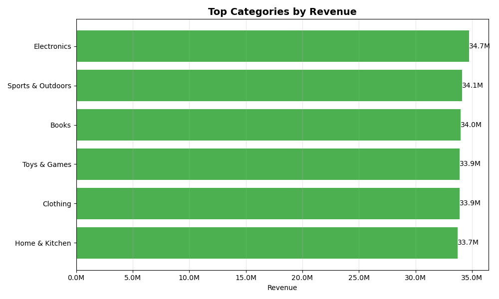
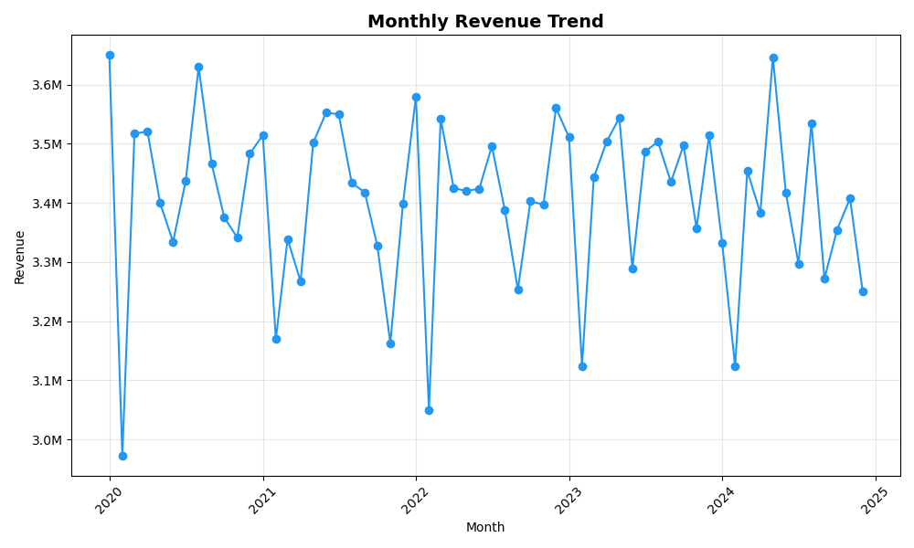
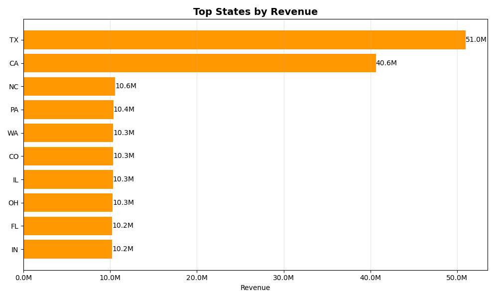

# 📊 Customer & Sales Analysis

This project focuses on analyzing customer behavior and sales performance using Python, MySQL, and Data Visualization.

---

## 🚀 Project Overview

In this project, I worked on a real-world e-commerce dataset to extract meaningful insights about:

- Sales performance over time  
- Top product categories  
- Customer distribution across locations  

The goal was to simulate a real Data Analyst / Data Engineer workflow:
- Data Cleaning (Python)
- Data Storage (MySQL)
- Data Analysis (SQL)
- Data Visualization (Matplotlib)

---

## 🛠️ Tools & Technologies

- Python 🐍
- Pandas
- Matplotlib
- MySQL
- SQL

---

## 📈 Key Insights

- 📌 Certain states (like Texas & California) generate the highest revenue  
- 📌 Revenue is relatively stable with fluctuations over time  
- 📌 Product categories contribute almost equally (dataset behavior insight)  

---

## 📊 Visualizations

### 🔹 Top States by Revenue

---

### 🔹 Monthly Revenue Trend

---

### 🔹 Top Categories by Revenue

---

## 🧠 SQL Analysis Examples

`sql
-- Total Revenue
SELECT ROUND(SUM(TotalAmount), 2) AS total_revenue
FROM amazon;

-- Top Categories by Revenue
SELECT Category, ROUND(SUM(TotalAmount), 2) AS revenue
FROM amazon
GROUP BY Category
ORDER BY revenue DESC;

-- Monthly Revenue Trend
SELECT DATE_FORMAT(OrderDate, '%Y-%m') AS month,
       ROUND(SUM(TotalAmount), 2) AS revenue
FROM amazon
GROUP BY month
ORDER BY month;

-- Top States by Revenue
SELECT State, ROUND(SUM(TotalAmount), 2) AS revenue
FROM amazon
GROUP BY State
ORDER BY revenue DESC
LIMIT 10;
