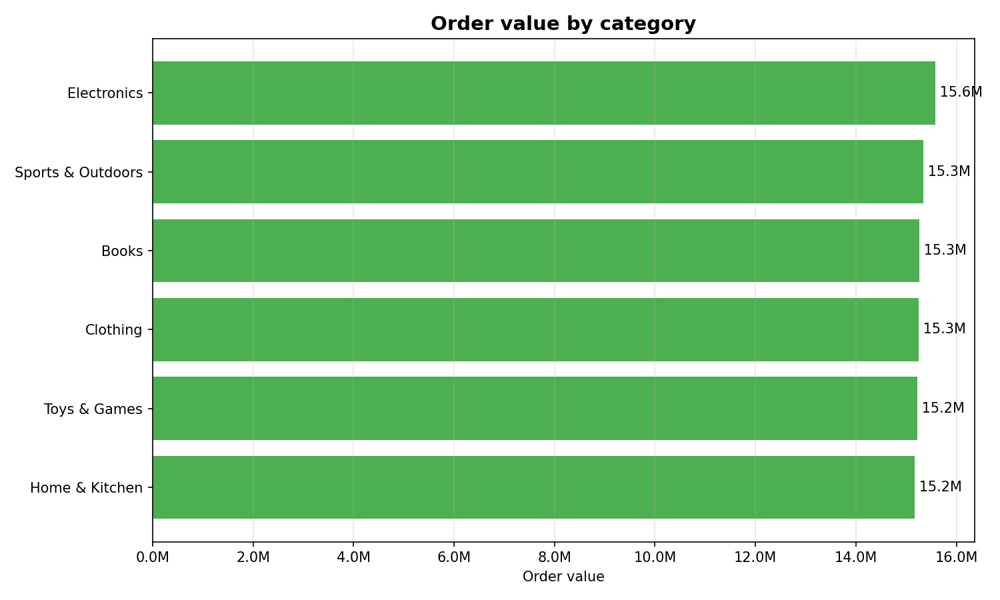
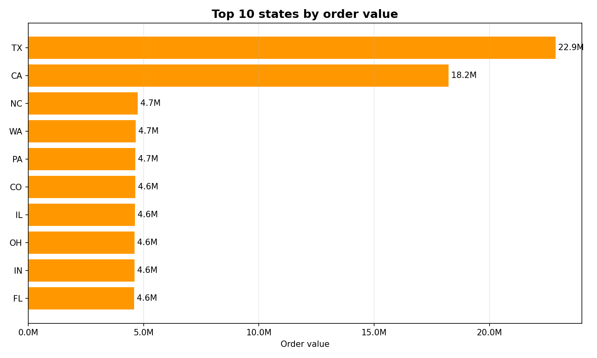
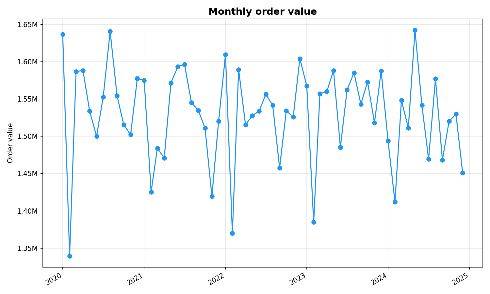

# Customer & Sales Analysis

Analysis of 100,000 e-commerce orders (`Amazon.csv`, January 2020 to December 2024) with Python and SQL: where the order value comes from, how it moves over time, and how much is lost to cancelled and returned orders.

## Key findings

All numbers come from `analysis.py` and can be reproduced by running it.

- **Total order value is 91.8M** across 100,000 orders. Cancelled and returned orders account for 5.6M of that (6.1%), leaving 86.2M.
- **Two states dominate.** Texas (22.9M) and California (18.2M) together make up about 45% of the order value. Every other state is below 4.8M.
- **No category stands out.** The six categories sit between 15.2M and 15.6M, a spread of 2.8% between the top (Electronics) and the bottom (Home & Kitchen).
- **Monthly order value is stable.** It averages 1.53M, with a low of 1.34M (February 2020) and a high of 1.64M (May 2024).
- **Cards are the main payment method.** Credit card 35.0% and debit card 20.0% of orders, then UPI 15.1% and Amazon Pay 15.0%. Cash on delivery is 4.9%.

## Data checks

Run before the analysis: 100,000 rows, no missing values, no duplicate order IDs, and `TotalAmount` equals `Quantity * UnitPrice * (1 - Discount) + Tax + ShippingCost` on every row.

Order values include all order statuses (Delivered, Shipped, Pending, Returned, Cancelled). The script prints the figure without cancelled and returned orders as well.

## Charts

| Order value by category | Top 10 states |
|---|---|
|  |  |



## Project structure

```
Amazon.csv            Order data (100,000 rows)
analysis.py           pandas analysis, writes charts to figures/ (no database needed)
analysis.sql          The same questions as MySQL queries
analysis_mysql.py     Optional: run the queries against MySQL and chart the result
figures/              Generated charts
```

## How to run

```bash
pip install -r requirements.txt
python analysis.py
```

### Optional: MySQL version

Load `Amazon.csv` into a MySQL table called `amazon` (database `ecommerce`), then:

```bash
pip install -r requirements-mysql.txt
MYSQL_PASSWORD=your_password python analysis_mysql.py
```

Connection settings are read from `MYSQL_HOST`, `MYSQL_USER`, `MYSQL_PASSWORD` and `MYSQL_DATABASE`. Nothing is stored in the code.

## SQL examples

`analysis.sql` holds the full set. A few of them:

```sql
-- Order value by category
SELECT Category, ROUND(SUM(TotalAmount), 2) AS revenue
FROM amazon
GROUP BY Category
ORDER BY revenue DESC;

-- Monthly trend
SELECT DATE_FORMAT(OrderDate, '%Y-%m') AS month,
       ROUND(SUM(TotalAmount), 2) AS revenue
FROM amazon
GROUP BY month
ORDER BY month;
```

## Tools

Python, pandas, Matplotlib, MySQL.

## Author

Hassan Ashraf. [Portfolio](https://hassan3443.github.io/) | [LinkedIn](https://www.linkedin.com/in/hassan1000/)
